# pulumi-python-aws-getting-started

The code from the blog post
[Getting Started with Pulumi and Python on AWS](https://benlabs.dev/blog/2026/11/06/getting-started-with-pulumi-python-aws/):
one private S3 bucket, deployed as a `dev` and a `prod` stack from the same code.
The post explains every file and command step by step.



## Requirements

- [Pulumi CLI](https://www.pulumi.com/docs/iac/download-install/)
- [uv](https://docs.astral.sh/uv/)
- AWS credentials in your shell

## Run it

```bash
git clone https://github.com/luisgb14/pulumi-python-aws-getting-started.git
cd pulumi-python-aws-getting-started

pulumi login --local          # or `pulumi login` for Pulumi Cloud
pulumi stack init dev         # uses the config in Pulumi.dev.yaml
pulumi preview
pulumi up
pulumi stack output bucket_uri
```

Deploy the `prod` stack, with versioning on, from the same code:

```bash
pulumi stack init prod        # uses the config in Pulumi.prod.yaml
pulumi up
```

## Clean up

```bash
pulumi destroy --stack dev --yes && pulumi stack rm dev --yes
pulumi destroy --stack prod --yes && pulumi stack rm prod --yes
```
